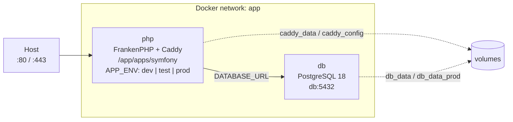

# Docker setup

This project runs entirely in containers: one PHP application server (FrankenPHP +
Caddy) and one PostgreSQL database. Docker Compose layers a shared base file with
environment-specific overrides, and a Makefile wraps the usual commands.



## File map

| Path | Role |
| --- | --- |
| `compose.yaml` | Shared services: `php` (built image) and `db`, network, volumes |
| `compose.override.yaml` | Dev: target `dev`, bind mount, configurable ports, Xdebug (off by default), Adminer, DB published on loopback |
| `compose.test.yaml` | Test: target `test`, no bind mount, throwaway tmpfs database `<db>_test`, run as the `<project>-test` Compose project |
| `compose.prod.yaml` | Prod: target `prod`, read-only non-root container, limits, log rotation, DB volume, backups |
| `makefile` | `make dev`, `make test`, `make prod`, ... |
| `docker/frankenphp/Dockerfile` | Multi-stage image (`base`, `dev`, `test`, `prod`) |
| `docker/frankenphp/Caddyfile.*` | One Caddy config per environment |
| `docker/frankenphp/php.ini.*` | PHP and OPcache settings per environment |
| `docker/frankenphp/docker-entrypoint.sh` | Dev-only dependency bootstrap |

The root stack is the only Compose stack. Flex Docker recipes are disabled
(`extra.symfony.docker: false` in the app), so there are no app-level Compose
files that could start a second database.

## Why these stack choices

### FrankenPHP instead of nginx + PHP-FPM

FrankenPHP is a PHP application server written in Go with Caddy embedded. It
replaces the usual nginx + php-fpm pair with one process and one container:

- one less moving part to configure, network, and monitor;
- modern protocols for free (HTTP/2, HTTP/3, TLS, compression);
- an optional worker mode for long-running Symfony kernels;
- an official image with `install-php-extensions`, so PHP extensions are easy to
  add without maintaining a custom compile chain.

The image is pinned to `dunglas/frankenphp:1-php8.4`. PHP 8.4 is supported by
Symfony 7.4 and receives security fixes longer than 8.3.

### Caddy instead of nginx

Caddy is embedded in FrankenPHP, so choosing it costs nothing extra. Its config is
short and readable (`Caddyfile`), it provisions and renews TLS certificates
automatically, and it compresses with zstd/brotli/gzip. Nginx would mean a second
process, a second config language, and a separate certificate workflow.

### PostgreSQL 18 (alpine)

- mature and fully supported by Doctrine DBAL/ORM;
- strong consistency and rich SQL, useful for a domain-heavy application;
- `-alpine` keeps the image small;
- the `pg_isready` healthcheck gives Compose a reliable readiness signal, so PHP
  starts only once the database accepts connections;
- PostgreSQL 18 stores data under `/var/lib/postgresql` (major-version-specific
  subdirectory), so Compose mounts that path rather than `.../data`.

### Multi-stage Dockerfile

| Stage | Purpose | Key differences |
| --- | --- | --- |
| `base` | Shared PHP runtime | System libs, PHP extensions, Composer |
| `dev` | Local development | Xdebug, `php.ini.dev`, bind mount, composer install on first boot |
| `test` | CI / `make test` | Source baked into image, pcov instead of Xdebug, no bind mount |
| `prod` | Production | `--no-dev` Composer, OPcache + JIT, unprivileged `app` user (uid 1000) |

Building separate stages keeps dev tools (Xdebug) out of production and lets the
test/prod images be immutable artifacts.

In `test` and `prod`, `composer.json` / `composer.lock` are copied and installed
before the sources, so a code change does not invalidate the vendor layer. Composer
downloads go through a BuildKit cache mount.

Each environment also tags its own image (`<project>-php:dev`, `:test`, `:prod`).
Without distinct tags, building `prod` would overwrite the image used by `make dev`,
and the dev stack would silently run the production Caddy/PHP config.

### Compose layering and the Makefile

`compose.yaml` holds only what every environment shares. Each override adds the
differences, so the three environments cannot drift apart silently. The Makefile
encodes the right `-f` combination:

```bash
make dev      # compose.yaml + compose.override.yaml
make test     # compose.yaml + compose.test.yaml, project <project>-test
make prod     # compose.yaml + compose.prod.yaml
```

`make help` lists every target. `BUILD=` (empty) skips the image rebuild, used by CI
after it built the image with a layer cache.

## PHP extensions

| Extension | Why |
| --- | --- |
| `pdo_pgsql`, `pgsql` | Doctrine / PostgreSQL |
| `intl` | Symfony translations, ICU formatting |
| `mbstring`, `iconv`, `ctype`, `tokenizer` | Symfony and libraries |
| `zip`, `xml`, `dom` | Composer, PHPSpreadsheet, XML handling |
| `opcache` | Bytecode cache in production |
| `apcu` | Local cache backend |
| `pcntl` | Worker/messenger signals |
| `gd` | Image processing (thumbnails, uploads) |
| `xdebug` | Dev only (`dev` stage) |

Image-level libraries (`libpq-dev`, `libicu-dev`, `libzip-dev`, image libraries)
are installed in `base` because the extensions compile against them.

## Development mode

- The Symfony application lives in `apps/symfony` and is bind-mounted into the
  container, so edits are visible immediately.
- OPcache is disabled and its timestamp checks are on (`php.ini.dev`).
- Xdebug is off by default (`XDEBUG_MODE=off`). `make dev.debug` restarts `php`
  with `debug,develop`. It listens on port 9003. On Linux, `host.docker.internal` is resolved via
  `extra_hosts: host.docker.internal:host-gateway` in `compose.override.yaml`.
- `docker-entrypoint.sh` runs `composer install` on first boot **only if
  `composer.json` exists** and `vendor/` is missing.
- Caddy serves `:80` without TLS for a simple local URL.
- Host ports are configurable in `.env` (`HTTP_PORT`, `HTTPS_PORT`, `DB_PORT`,
  `ADMINER_PORT`) so several projects can run side by side. The database and Adminer
  are published on `127.0.0.1` only.
- Adminer runs at `http://localhost:8080` (system PostgreSQL, server `db`, then the
  `POSTGRES_*` values from `.env`). It exists only in the dev stack.
- The Symfony profiler (`symfony/web-profiler-bundle`, dev only) shows its toolbar
  on every page and the full profile at `/_profiler`.
- `php` has a healthcheck, and `docker compose watch` re-runs `composer install` or
  `importmap:install` when `composer.lock` or `importmap.php` change.

## Test mode

- The image bakes the source and dependencies at build time; there is no bind
  mount, so tests run against exactly what was built.
- `make test` passes `--build`, so the image is rebuilt before each run (cheap
  thanks to the layer cache).
- `APP_ENV=test`, `APP_SECRET=test`; `DATABASE_URL` targets `<POSTGRES_DB>_test`.
- The stack runs as its own Compose project, `<project>-test` (`docker compose -p`).
  Containers, network and volumes are separate from dev, so running the tests can
  never recreate or touch the dev database. Sharing one project name makes Compose
  recreate the dev `db` container with the test configuration.
- The test database lives on a `tmpfs`: nothing persists, nothing to clean up.
  `make test` and `make lint` run `make test.down` at the end, success or not.
- `make behat` first runs `make database.test.prepare` (create the database if
  needed, run the migrations). `DatabaseContext` then truncates every table before
  each scenario, so scenarios create their own data. Doctrine fixtures are loaded in
  dev only, never in test.
- `make db.restore.test [FILE=backups/x.dump]` restores a dump in that throwaway
  database and lists the tables, to prove a backup is usable.

## Production mode

- Source is copied into the image, `composer install --no-dev` runs at build time,
  and the autoloader is classmap-authoritative.
- OPcache is enabled with JIT; `validate_timestamps=0` because files do not change
  inside the image.
- `Caddyfile.prod` uses `{$SERVER_NAME:localhost}` and automatic HTTPS. Set
  `SERVER_NAME` to the real domain and expose ports 80/443.
- Worker mode is intentionally **disabled**. PHP workers require
  `runtime/frankenphp-symfony` and careful service reset; enabling it without that
  leaks state between requests. See below to opt in.
- The `php` container runs as the unprivileged `app` user, with a read-only
  filesystem, `var/` on a tmpfs, all capabilities dropped except
  `NET_BIND_SERVICE`, memory/CPU limits (`PHP_MEM_LIMIT`, `PHP_CPUS`,
  `DB_MEM_LIMIT`) and rotated logs. UDP 443 is published for HTTP/3.
- `make prod` refuses the dev placeholder `APP_SECRET`. `POSTGRES_PASSWORD` is
  required.
- `db-backup` dumps the database daily and keeps 7 days in `db_backups`.
  `make prod.offsite` also starts `db-offsite`, which copies the dumps to an rclone
  remote (`OFFSITE_REMOTE`, config in git-ignored `docker/rclone/rclone.conf`).
  Run `make db.restore.test` regularly: a backup that was never restored is not a
  backup.
- Composer scripts are skipped at build time (`--no-scripts`) to avoid building a
  cache without runtime configuration. Warm it at deploy time if needed:

  ```bash
  docker compose -f compose.yaml -f compose.prod.yaml run --rm php bin/console cache:warmup
  ```

## Environment variables

The root `.env` is the single source of runtime configuration. There is no
`apps/symfony/.env`: `symfony/dotenv` was removed, so Symfony reads only the
container environment variables that Compose injects.

| File | Committed | Purpose |
| --- | --- | --- |
| `.env.dist` | yes | Template defaults; copy to `.env` |
| `.env` | no (ignored) | Single source: app + Compose values |
| Compose `environment:` / orchestrator secrets | n/a | Production values |

The variables have one consumer each:

- `DATABASE_URL` is the only database value injected into the `php` container.
- `POSTGRES_DB`, `POSTGRES_USER`, `POSTGRES_PASSWORD` configure the `db`
  container at initialization. They are not passed to PHP: the Postgres image
  needs them, while the application only needs the resulting URL.
- `APP_SECRET`, `APP_SHARE_DIR` and `DEFAULT_URI` are injected into PHP from the
  root `.env`; `APP_ENV` comes from the Compose profile.
- `SENTRY_DSN` is optional; an empty value disables Sentry reporting.

Required production values:

- `APP_SECRET` (the `.env.dist` value is a dev placeholder) — generate with `openssl rand -hex 32`;
- `SERVER_NAME` — public hostname for Caddy/ACME;
- `POSTGRES_DB`, `POSTGRES_USER`, `POSTGRES_PASSWORD` — db container init only, use real secrets;
- `DATABASE_URL` — point at the managed database in a real deployment.

Never bake production secrets into the image or commit `.env`.

## Assets

The template assumes **Symfony AssetMapper**. It needs no Docker build
stage: assets are served/handled by PHP, and production uses:

```bash
php bin/console asset-map:compile
```

Add that command to the `prod` stage once AssetMapper is installed. If the project
later chooses Webpack Encore/npm, add a dedicated `node` stage back to the
Dockerfile and copy `public/build` into the `prod` stage. Do not keep both
pipelines.

## Enabling FrankenPHP worker mode (optional)

1. `composer require runtime/frankenphp-symfony`
2. Add `runtime: frankenphp` to `config/packages/runtime.yaml`.
3. Configure workers in `Caddyfile.prod`:

   ```caddyfile
   {$SERVER_NAME:localhost} {
       root * /app/apps/symfony/public
       encode zstd br gzip
       php_server {
           worker /app/apps/symfony/public/index.php 2
       }
       file_server
   }
   ```

4. Verify the kernel resets state between requests; services that hold request
   data must be stateless or reset explicitly.

## Volumes and data

| Volume | Used by | Content |
| --- | --- | --- |
| `db_data` | dev | Development database |
| `db_data_prod` | prod | Production database |
| `db_backups` | prod | Automatic daily database backups |
| `caddy_data` | dev/prod | TLS certificates and Caddy state |
| `caddy_config` | dev/prod | Caddy runtime config |

The test stack has no volume (tmpfs). Back up production data with `pg_dump`; volumes are not backups.

## Common commands

```bash
make help                 # list every target
make dev                  # start dev stack
make dev.debug            # restart php with Xdebug
make shell                # shell in the dev php container
make logs                 # follow dev logs
make composer ARGS="..."  # run composer in the dev container
make stop                 # stop every compose project
make test                 # PHPUnit + Behat (migrated, truncated DB), then remove the test stack
make lint                 # PHPStan (max), PHP-CS-Fixer, Deptrac
make prod                 # build and start production stack
make db.backup            # dump the production database to ./backups
make db.restore.test      # prove a dump restores
```

## CI

`.github/workflows/ci.yml` runs three parallel jobs: `test`, `lint` and
`prod-image`. The test image is built with `docker/build-push-action` and a GitHub
Actions layer cache, then `make ... BUILD=` reuses it. `prod-image` smoke-tests the
hardened production container and scans it with Trivy (critical and high, fixed
vulnerabilities only). Dependabot watches the Dockerfile, the compose files, Composer
and the actions.
