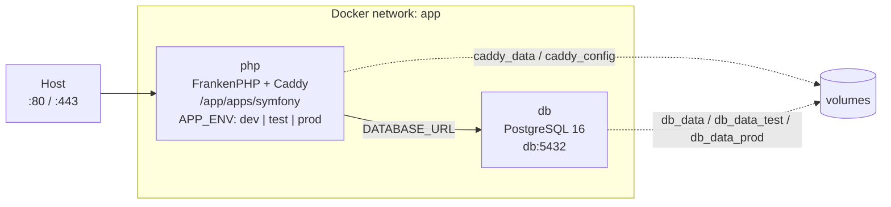

# Docker setup

This project runs entirely in containers: one PHP application server (FrankenPHP +
Caddy) and one PostgreSQL database. Docker Compose layers a shared base file with
environment-specific overrides, and a Makefile wraps the usual commands.



## File map

| Path | Role |
| --- | --- |
| `compose.yaml` | Shared services: `php` (built image) and `db`, network, volumes |
| `compose.override.yaml` | Dev: target `dev`, bind mount, ports 80/443, Xdebug, DB published on 5432 |
| `compose.test.yaml` | Test: target `test`, no bind mount, separate DB volume |
| `compose.prod.yaml` | Prod: target `prod`, restart policy, separate DB volume |
| `makefile` | `make dev`, `make test`, `make prod`, ... |
| `docker/frankenphp/Dockerfile` | Multi-stage image (`base`, `dev`, `test`, `prod`) |
| `docker/frankenphp/Caddyfile.*` | One Caddy config per environment |
| `docker/frankenphp/php.ini.*` | PHP and OPcache settings per environment |
| `docker/frankenphp/docker-entrypoint.sh` | Dev-only dependency bootstrap |

The root stack is the only Compose stack. Flex Docker recipes are disabled
(`extra.symfony.docker: false` in the app), so there are no app-level Compose
files that could start a second database.

## Why these stack choices

### FrankenPHP instead of nginx + PHP-FPM

FrankenPHP is a PHP application server written in Go with Caddy embedded. It
replaces the usual nginx + php-fpm pair with one process and one container:

- one less moving part to configure, network, and monitor;
- modern protocols for free (HTTP/2, HTTP/3, TLS, compression);
- an optional worker mode for long-running Symfony kernels;
- an official image with `install-php-extensions`, so PHP extensions are easy to
  add without maintaining a custom compile chain.

The image is pinned to `dunglas/frankenphp:1-php8.4`. PHP 8.4 is supported by
Symfony 7.4 and receives security fixes longer than 8.3.

### Caddy instead of nginx

Caddy is embedded in FrankenPHP, so choosing it costs nothing extra. Its config is
short and readable (`Caddyfile`), it provisions and renews TLS certificates
automatically, and it compresses with zstd/brotli/gzip. Nginx would mean a second
process, a second config language, and a separate certificate workflow.

### PostgreSQL 16 (alpine)

- mature and fully supported by Doctrine DBAL/ORM;
- strong consistency and rich SQL, useful for a domain-heavy application;
- `-alpine` keeps the image small;
- the `pg_isready` healthcheck gives Compose a reliable readiness signal, so PHP
  starts only once the database accepts connections.

### Multi-stage Dockerfile

| Stage | Purpose | Key differences |
| --- | --- | --- |
| `base` | Shared PHP runtime | System libs, PHP extensions, Composer |
| `dev` | Local development | Xdebug, `php.ini.dev`, bind mount, composer install on first boot |
| `test` | CI / `make test` | Source baked into image, no Xdebug, no bind mount |
| `prod` | Production | `--no-dev` Composer, OPcache + JIT, no source rebuild at runtime |

Building separate stages keeps dev tools (Xdebug) out of production and lets the
test/prod images be immutable artifacts.

Each environment also tags its own image (`<project>-php:dev`, `:test`, `:prod`).
Without distinct tags, building `prod` would overwrite the image used by `make dev`,
and the dev stack would silently run the production Caddy/PHP config.

### Compose layering and the Makefile

`compose.yaml` holds only what every environment shares. Each override adds the
differences, so the three environments cannot drift apart silently. The Makefile
encodes the right `-f` combination:

```bash
make dev      # compose.yaml + compose.override.yaml
make test     # compose.yaml + compose.test.yaml
make prod     # compose.yaml + compose.prod.yaml
```

## PHP extensions

| Extension | Why |
| --- | --- |
| `pdo_pgsql`, `pgsql` | Doctrine / PostgreSQL |
| `intl` | Symfony translations, ICU formatting |
| `mbstring`, `iconv`, `ctype`, `tokenizer` | Symfony and libraries |
| `zip`, `xml`, `dom` | Composer, PHPSpreadsheet, XML handling |
| `opcache` | Bytecode cache in production |
| `apcu` | Local cache backend |
| `pcntl` | Worker/messenger signals |
| `gd` | Image processing (thumbnails, uploads) |
| `xdebug` | Dev only (`dev` stage) |

Image-level libraries (`libpq-dev`, `libicu-dev`, `libzip-dev`, image libraries)
are installed in `base` because the extensions compile against them.

## Development mode

- The Symfony application lives in `apps/symfony` and is bind-mounted into the
  container, so edits are visible immediately.
- OPcache is disabled and its timestamp checks are on (`php.ini.dev`).
- Xdebug listens on port 9003. On Linux, `host.docker.internal` is resolved via
  `extra_hosts: host.docker.internal:host-gateway` in `compose.override.yaml`.
- `docker-entrypoint.sh` runs `composer install` on first boot **only if
  `composer.json` exists** and `vendor/` is missing. This also allows
  `make init-symfony` to run `composer create-project` in an empty directory.
- Caddy serves `:80` without TLS for a simple local URL.

## Test mode

- The image bakes the source and dependencies at build time; there is no bind
  mount, so tests run against exactly what was built.
- `make test` passes `--build`, so the image is rebuilt before each run.
- `APP_ENV=test`, `APP_SECRET=test`; `DATABASE_URL` is the same as dev
  (`db:5432/database`).
- Isolation comes from the `db_data_test` volume, not from a second database
  name. Dev, test and prod each get their own volume and can reuse the same
  database name.
- To start from an empty test database:

  ```bash
  docker compose -f compose.yaml -f compose.test.yaml down -v
  ```

## Production mode

- Source is copied into the image, `composer install --no-dev` runs at build time,
  and the autoloader is classmap-authoritative.
- OPcache is enabled with JIT; `validate_timestamps=0` because files do not change
  inside the image.
- `Caddyfile.prod` uses `{$SERVER_NAME:localhost}` and automatic HTTPS. Set
  `SERVER_NAME` to the real domain and expose ports 80/443.
- Worker mode is intentionally **disabled**. PHP workers require
  `runtime/frankenphp-symfony` and careful service reset; enabling it without that
  leaks state between requests. See below to opt in.
- Composer scripts are skipped at build time (`--no-scripts`) to avoid building a
  cache without runtime configuration. Warm it at deploy time if needed:

  ```bash
  docker compose -f compose.yaml -f compose.prod.yaml run --rm php bin/console cache:warmup
  ```

## Environment variables

The root `.env` is the single source of runtime configuration. There is no
`apps/symfony/.env`: `symfony/dotenv` was removed, so Symfony reads only the
container environment variables that Compose injects.

| File | Committed | Purpose |
| --- | --- | --- |
| `.env.dist` | yes | Template defaults; copy to `.env` |
| `.env` | no (ignored) | Single source: app + Compose values |
| Compose `environment:` / orchestrator secrets | n/a | Production values |

The variables have one consumer each:

- `DATABASE_URL` is the only database value injected into the `php` container.
- `POSTGRES_DB`, `POSTGRES_USER`, `POSTGRES_PASSWORD` configure the `db`
  container at initialization. They are not passed to PHP: the Postgres image
  needs them, while the application only needs the resulting URL.
- `APP_SECRET`, `APP_SHARE_DIR` and `DEFAULT_URI` are injected into PHP from the
  root `.env`; `APP_ENV` comes from the Compose profile.

Required production values:

- `APP_SECRET` — generate with `openssl rand -hex 32`;
- `SERVER_NAME` — public hostname for Caddy/ACME;
- `POSTGRES_DB`, `POSTGRES_USER`, `POSTGRES_PASSWORD` — db container init only, use real secrets;
- `DATABASE_URL` — point at the managed database in a real deployment.

Never bake production secrets into the image or commit `.env`.

## Assets

The template assumes **Symfony AssetMapper**. It needs no Docker build
stage: assets are served/handled by PHP, and production uses:

```bash
php bin/console asset-map:compile
```

Add that command to the `prod` stage once AssetMapper is installed. If the project
later chooses Webpack Encore/npm, add a dedicated `node` stage back to the
Dockerfile and copy `public/build` into the `prod` stage. Do not keep both
pipelines.

## Enabling FrankenPHP worker mode (optional)

1. `composer require runtime/frankenphp-symfony`
2. Add `runtime: frankenphp` to `config/packages/runtime.yaml`.
3. Configure workers in `Caddyfile.prod`:

   ```caddyfile
   {$SERVER_NAME:localhost} {
       root * /app/apps/symfony/public
       encode zstd br gzip
       php_server {
           worker /app/apps/symfony/public/index.php 2
       }
       file_server
   }
   ```

4. Verify the kernel resets state between requests; services that hold request
   data must be stateless or reset explicitly.

## Volumes and data

| Volume | Used by | Content |
| --- | --- | --- |
| `db_data` | dev | Development database |
| `db_data_test` | test | Test database |
| `db_data_prod` | prod | Production database |
| `caddy_data` | dev/prod | TLS certificates and Caddy state |
| `caddy_config` | dev/prod | Caddy runtime config |

Back up production data with `pg_dump`; volumes are not backups.

## Common commands

```bash
make dev                  # start dev stack
make stop                 # stop every compose project
make build                # build the dev image
make init-symfony         # create the Symfony skeleton in apps/symfony
make test                 # rebuild + run PHPUnit
make lint                 # PHPStan (max), PHP-CS-Fixer, Deptrac
make phpstan         # PHPStan (max)
make deptrac         # Deptrac layer rules
make cs-fixer              # PHP-CS-Fixer dry run
make prod                 # build and start production stack

docker compose -f compose.yaml -f compose.override.yaml logs -f php
docker compose -f compose.yaml -f compose.override.yaml exec php sh
```
